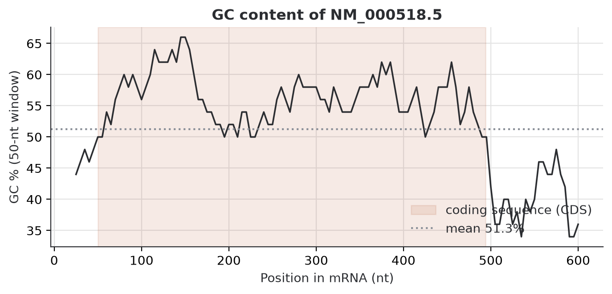
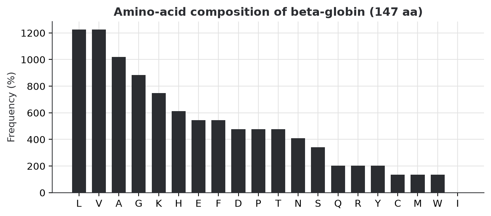
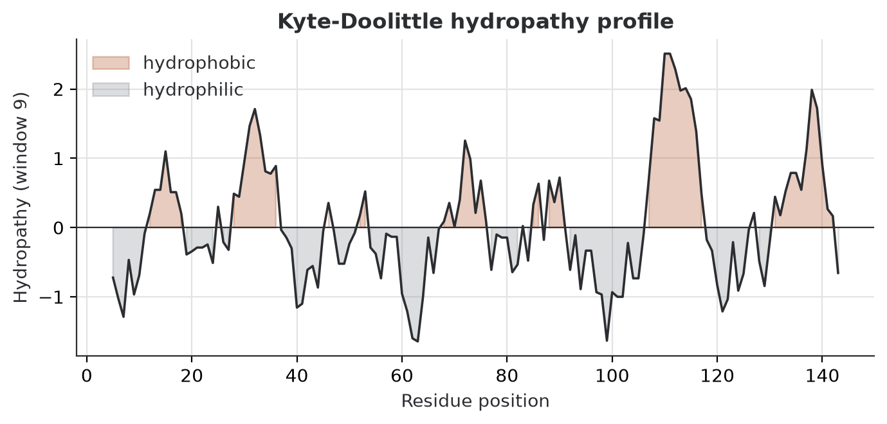
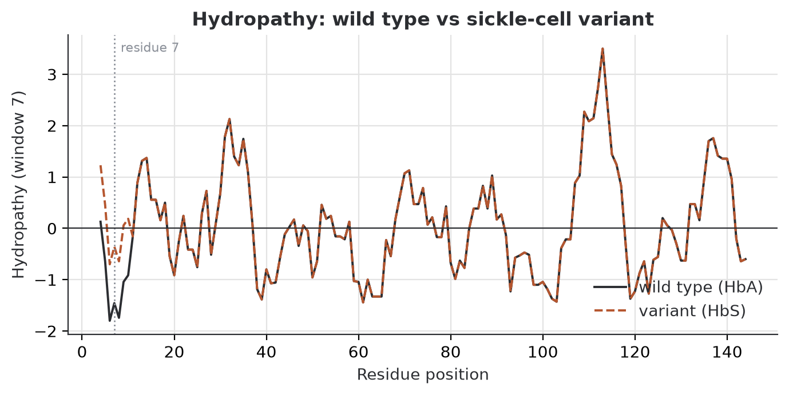
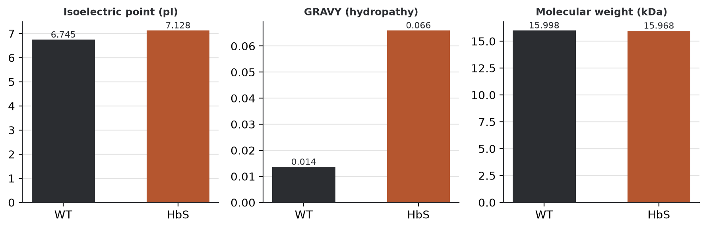
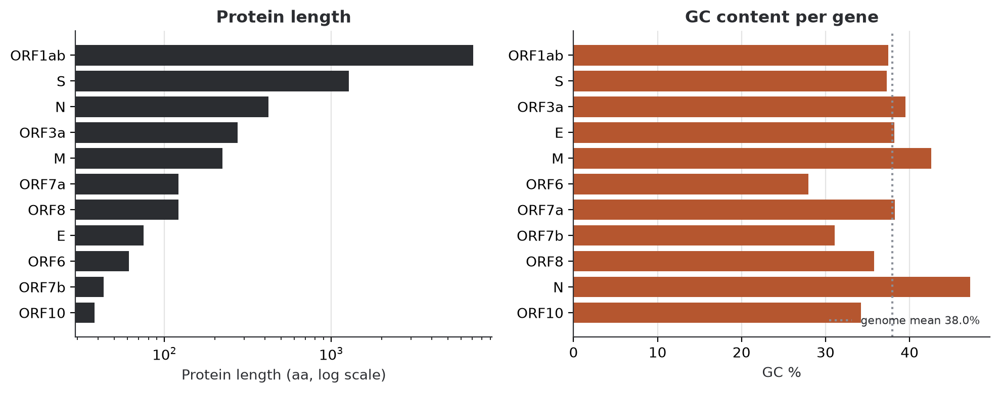
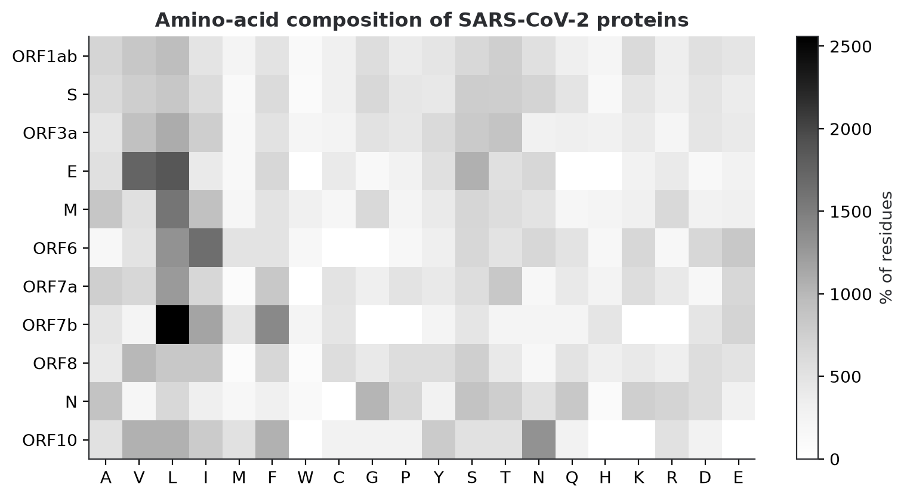
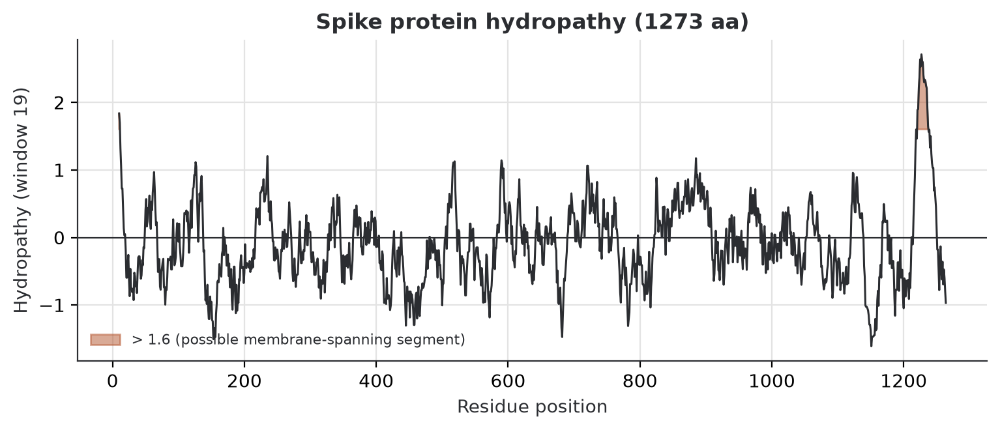

# Bioinformatics portfolio

Small, reproducible sequence-analysis projects written in Python with Biopython. Every script
downloads a real record from NCBI, analyses it, and writes charts and tables to `results/`.

**Skills shown:** sequence retrieval (NCBI Entrez), GenBank parsing, CDS extraction and translation,
GC-content profiling, amino-acid composition, hydropathy and protein properties (ProtParam),
in-silico variant analysis, data visualisation (Matplotlib), tidy tables (pandas).

## Projects

### 1. Anatomy of a human gene: HBB (beta-globin) mRNA — `01_hbb_gene_analysis.py`
GC content along the mRNA with the coding region highlighted, amino-acid composition and a
Kyte-Doolittle hydropathy profile of the translated protein. Data: NCBI `NM_000518`.





### 2. One DNA letter, one amino acid: the sickle-cell variant — `02_sickle_cell_variant.py`
The reference HBB coding sequence is edited in silico at c.20A>T (HbS, rs334). The script
translates both versions, reports the protein change and compares hydropathy, isoelectric point,
GRAVY and molecular weight.




### 3. Genes and proteins of SARS-CoV-2 — `03_sars_cov2_proteome.py`
Every CDS of the reference genome (`NC_045512.2`) is extracted and translated; the script compares
protein length, GC content and amino-acid composition, and plots the Spike hydropathy profile.





## Run it yourself

```bash
python -m venv .venv
.venv\Scripts\activate          # Windows  (Linux/macOS: source .venv/bin/activate)
pip install -r requirements.txt
set ENTREZ_EMAIL=you@example.com   # NCBI asks for a contact e-mail (Linux/macOS: export ...)
python 01_hbb_gene_analysis.py
python 02_sickle_cell_variant.py
python 03_sars_cov2_proteome.py
```

Downloaded records are cached in `data/`, so later runs work offline.

## Notes

* Sequences come from NCBI RefSeq. The sickle-cell sequence is a computational edit of the
  reference, not a sequenced sample.
* Results are computational and illustrative; they are not clinical or diagnostic information.
